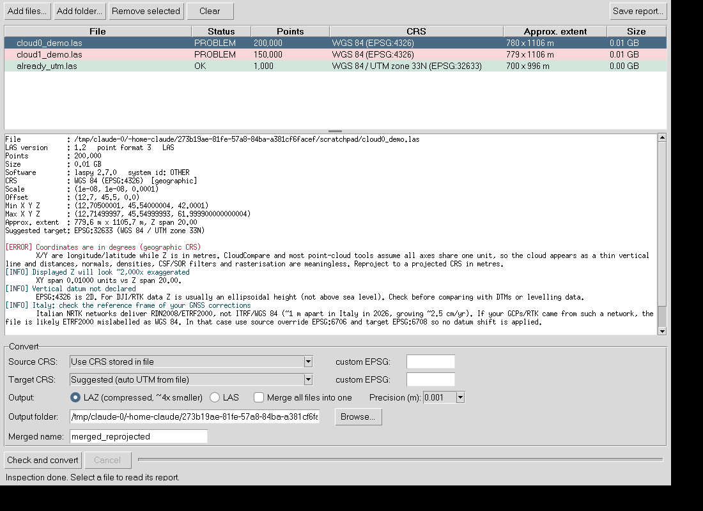

# LAS CRS Doctor

Check LAS/LAZ point clouds for coordinate reference system (CRS) problems and reproject them to a metric CRS, with a simple GUI and a command line tool.

Built for a recurring problem: **DJI Terra exports LiDAR clouds in geographic WGS 84 (EPSG:4326)**. X/Y are then longitude/latitude in degrees while Z is in metres. CloudCompare and most point-cloud software treat the three axes as the same unit, so a field of 800 x 1100 m shows up as a thin vertical line (Z exaggerated ~2000x), and every metric operation (distances, normals, density, CSF/SOR filtering, rasterisation) is wrong.



## What it checks

| Check | Level |
|---|---|
| Coordinates in degrees (geographic CRS, or no CRS but values look like lon/lat) | ERROR |
| No CRS stored in the file | WARN |
| CRS VLR present but unreadable | WARN |
| CRS says projected but values look like degrees (wrong label) | ERROR |
| Projected CRS not in metres (e.g. US feet) | WARN |
| XY scale too coarse for the CRS | WARN |
| Header min/max do not match the points | WARN |
| Uncompressed file shorter than the header announces (truncated export/copy) | ERROR |
| Unrealistic Z range | WARN |
| More than 4.29 billion points in LAS < 1.4 | ERROR |
| Vertical datum not declared (Z probably ellipsoidal height) | INFO |
| Data in Italy labelled WGS 84: possible RDN2008/ETRF2000 mislabel | INFO |

It also decodes the DJI system identifier (stored as base64, e.g. `DJI-L1-HPC01-win.`) and suggests the UTM zone for the data.

## What the conversion does

* Reprojects X/Y (and Z, if the datum changes) with PROJ through `pyproj`, reading and writing in chunks, so files larger than RAM work.
* Keeps every point attribute (intensity, GPS time, RGB, classification, returns, ...) and the point order.
* Writes the target CRS into the output header, sets sensible offsets and a scale you choose (default 1 mm).
* Optionally merges several files into one (all inputs must have the same point format).
* Writes LAZ (about 4x smaller than LAS) or LAS.
* **Before** running: checks free disk space, refuses to overwrite inputs, blocks merging of incompatible files, warns if the target is geographic.
* **After** running: re-reads random points (plus the first and last of each input), transforms them independently and compares them with the output; reports the maximum error and whether attributes match.

The original files are never modified.

## Install

Requires Python 3.9 or newer with Tkinter. On Windows use the python.org installer and tick "Add python.exe to PATH" (it includes Tkinter; the Microsoft Store "python" shortcut is not enough).

**Easiest: double-click the launcher**

* Windows: `start_gui.bat`
* Linux/macOS: `./start_gui.sh`

The first run creates a private environment in `.venv` inside the folder and installs the dependencies (about a minute, needs internet). Later runs open the GUI directly. The install is editable, so after `git pull` the launcher runs the new code; if dependencies change, delete `.venv` and launch again. If the window never appears on Windows, run `.venv\Scripts\python.exe -m lascrs` in that folder to see the error.

**Manual install**

```bash
git clone <repo-url>
cd las-crs-doctor
python -m venv .venv
# Windows: .venv\Scripts\activate     Linux/macOS: source .venv/bin/activate
pip install .
```

## Use

GUI:

```bash
lascrs-gui          # or: python -m lascrs
```

1. **Add files...** or **Add folder...**. Each file is inspected; red = problem, yellow = warning, green = OK. Click a file to read its report.
2. Pick the **source CRS** (normally "Use CRS stored in file") and the **target CRS** ("Suggested" picks the UTM zone from the data).
3. Choose LAZ/LAS, precision, whether to merge, and the output folder.
4. **Check and convert**. The pre-flight checks are shown before anything is written. Selected rows are converted; with no selection, all rows are.

Command line (handy on servers/HPC):

```bash
lascrs inspect cloud0.las cloud1.las               # exit code 1 if any ERROR
lascrs convert cloud0.las                          # -> cloud0_epsg32633.laz (auto UTM)
lascrs convert tiles/*.las --merge -o all.laz -t 32633
lascrs convert cloud0.las -s 6706 -t 6708 --las    # RDN2008 case, see below
```

## Which target CRS?

Use a **projected CRS in metres** that covers your site, normally the UTM zone (the tool suggests it). Two cases matter in practice:

**Plain WGS 84 data** (no RTK corrections, or corrections in ITRF): `WGS 84 / UTM zone NN` (EPSG:326NN north, 327NN south).

**RTK/GCPs from a national network (Italy and the rest of Europe).** Italian NRTK networks deliver coordinates in **RDN2008 = ETRF2000** (European networks in general deliver ETRS89 realisations), not in ITRF/WGS 84. The two frames drift apart by about 2.5 cm/yr; in northern Italy in 2026 the difference is about 1 m horizontally (computed with PROJ's ITRF2014 to ETRF2000 transformation). DJI Terra nevertheless labels the output "WGS 84". If that is your case the numbers are really ETRF2000, so:

* source override: **EPSG:6706** (RDN2008 geographic)
* target: **EPSG:6707 / 6708 / 6709** (RDN2008 / UTM 32N / 33N / 34N)

This is a pure map projection with no datum shift. If instead you convert from EPSG:4326 to an ETRF-based CRS, PROJ may apply (or approximate) a datum shift to coordinates that were already ETRF2000. **Which frame your data are in depends on how your GNSS receiver and GCP survey were set up; the tool cannot detect it from the file.** Check it before choosing.

## Limitations

* **Heights stay ellipsoidal.** Z is not converted to orthometric height (above sea level). That needs a geoid model (in Italy, ITALGEO, which is distributed under licence) and is not included.
* Inspection reads the header and the first 200,000 points, so it does not scan whole files for outliers.
* Verification samples points; it is a check of the transformation, not a full comparison.
* Merging needs identical point formats and extra dimensions.
* Cancelling leaves an incomplete output file. Delete it.
* UTM suggestion ignores the special Norway/Svalbard zones.

## Development

```bash
pip install -e . pytest
pytest
```

Tests build synthetic LAS/LAZ files that mimic a DJI Terra export near 12.7°E, 45.54°N and check inspection, conversion accuracy against `pyproj`, attribute preservation, merging, source override, pre-flight blocking, cancelling and the CLI.

## License

MIT, see `LICENSE`.
